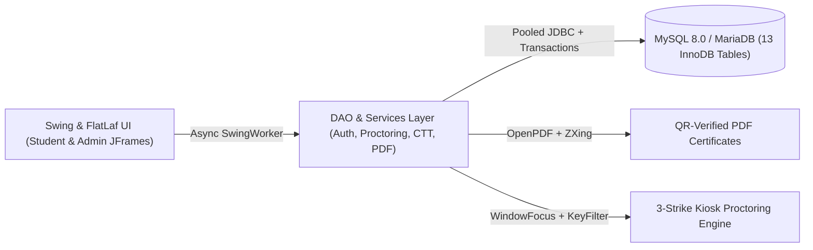

<div align="center">


# 🎓 Online Examination Management System (OEMS)

**Secure Desktop Assessment Platform with Multi-Channel Proctoring, Psychometric Analytics & QR-Verified Certification**

<p align="center">
  <a href="https://drive.google.com/file/d/1OsGQHxEmHiaKSQwqbjMwYxkCB3dn8TfZ/view?usp=sharing">
    
  </a>
  <a href="./docs/Online%20Examination%20Management%20System%20(OEMS)%20-%20Java%20Project%20Report.pdf">
    
  </a>
  <a href="./OnlineExamSystem.jar">
    
  </a>
  
  
  
</p>

<p align="center">
  <a href="#-live-demo--project-resources">Video Stream</a> •
  <a href="#-core-innovations">Core Innovations</a> •
  <a href="#-interactive-workflows">Interactive Workflows</a> •
  <a href="#-system-architecture">Architecture</a> •
  <a href="#-tech-stack">Tech Stack</a> •
  <a href="#-quick-start">Quick Start</a> •
  <a href="#%EF%B8%8F-cloud-deployment-docker--novnc">Cloud Deploy</a>
</p>

</div>

---

## 🎬 Live Demo & Project Resources

> **🔗 Video Stream Link:** https://drive.google.com/file/d/1OsGQHxEmHiaKSQwqbjMwYxkCB3dn8TfZ/view?usp=sharing

| Resource | Description | Link |
| :--- | :--- | :--- |
| **🎥 Presentation & Live UI Demo** | Full video walkthrough covering architecture, code, and live Student/Admin flows | [**Watch on Google Drive ↗**](https://drive.google.com/file/d/1OsGQHxEmHiaKSQwqbjMwYxkCB3dn8TfZ/view?usp=sharing) |
| **📘 Formal Project Report** | Complete academic documentation, ER/system design, and implementation details | [**Open Report PDF ↗**](./docs/Online%20Examination%20Management%20System%20(OEMS)%20-%20Java%20Project%20Report.pdf) |
| **📦 Pre-Built Executable** | Java 17 compiled application ready to run locally with `lib/` dependencies | [**OnlineExamSystem.jar ↗**](./OnlineExamSystem.jar) |

---

## 🚀 Core Innovations

<table width="100%">
<tr>
<td width="50%" valign="top">

### 🛡️ Multi-Channel Proctoring Engine
- **Window Focus Interceptor:** Real-time detection of OS window switches (`Alt+Tab`, Windows key, app switching) via `WindowFocusListener`.
- **Global Keystroke Filtering:** Hooks `KeyboardFocusManager` to block restricted shortcuts (`Ctrl+C`, `Ctrl+V`, `Alt+F4`, function keys).
- **Automated Snapshot Auditing:** Background proctoring support (`ProctorDAO` & `WebcamProctorService`) logging visual snapshots and threat events.
- **3-Strike Kiosk Termination:** Automatically ends the testing session and executes atomic submission if violation limits are exceeded.

</td>
<td width="50%" valign="top">

### 🔐 Cryptographic Auth & Session Integrity
- **PBKDF2-HMAC-SHA256:** 120,000 key-stretching iterations via `javax.crypto.SecretKeyFactory` to resist brute-force attacks.
- **128-Bit CSPRNG Salts:** Cryptographically random per-user salts generated via `java.security.SecureRandom`.
- **Transparent Hash Upgrades:** Automatically migrates legacy passwords to PBKDF2 on successful sign-in.
- **UUID Concurrent Session Lock:** Single-device token enforcement paired with a 30-second `SessionHeartbeat` to prevent proxy logins.

</td>
</tr>
<tr>
<td width="50%" valign="top">

### 📊 Psychometric Item Analytics (CTT)
- **Facility Value (Item Difficulty):**
  $$\mathbf{P = \frac{R}{N}}$$
  *Classifies questions into Easy, Optimal, or Difficult/Ambiguous tiers.*
- **Discrimination Index ($\mathbf{D}$):**
  $$\mathbf{D = \frac{U - L}{N_G}}$$
  *Measures item discrimination across top and bottom 27% cohorts (Kelley's Rule).*
- **Distractor Efficiency Audit:** Flags non-functioning options and misleading distractors.

</td>
<td width="50%" valign="top">

### 📜 Tamper-Proof Vector Certification
- **Dynamic PDF Generation:** Vector certificates rendered via `OpenPDF` with candidate metrics, grades, and formatting.
- **SHA-256 Digital Fingerprint:** Cryptographic verification checksum computed across student ID, exam ID, and score.
- **2D QR Matrix Verification:** High-density `ZXing` QR code verifiable in-app through `VerifyCertificateUI.java`.
- **Persistent Certificate Ledger:** Real-time authenticity verification preventing forged academic credentials.

</td>
</tr>
<tr>
<td width="50%" valign="top">

### ⚡ Responsive Modern Desktop UX
- **FlatLaf + Glassmorphic UI:** Clean light design tokens, LCD sub-pixel text rendering, frosted cards (`GlassPanel`), and maximized windows by default.
- **EDT Concurrency Isolation:** Expensive PBKDF2 hashing and analytics queries run asynchronously on `SwingWorker` threads.
- **24 FPS Particle Backdrop:** `AuroraBackground.java` throttles rendering automatically when minimized to save CPU.
- **Custom Java2D Radar Charts:** Multi-axis competency radar projection visualizing subject-wise student mastery.

</td>
<td width="50%" valign="top">

### 🔄 Resilient Persistence & Transactions
- **Pooled JDBC Layer:** Thread-safe connection reuse and socket pre-warming in `DBConnection.java`.
- **Two-Phase Atomic Transactions:** `COMMIT` and `ROLLBACK` guarantees saving exam attempts and answers synchronously.
- **Idempotent Schema Migration:** `SchemaMigrator.java` automatically creates/upgrades tables and seeds data at startup.
- **Auto-MySQL Windows Launchers:** `run.ps1` and `run.bat` detect port `3306` and start local MySQL automatically if needed.

</td>
</tr>
</table>

---

## 🎯 Interactive Workflows

Click any role below to explore the step-by-step experience inside the application:

<details>
<summary><b>👨‍🎓 Student Portal Workflow (Auth ➔ Kiosk Exam ➔ Scorecard & QR Certificate)</b></summary>
<br/>

1. **Secure Sign-In / Registration (`LoginUI`, `SignupUI`):**
   - Passwords are validated with live strength feedback (`PasswordStrengthMeter`) and hashed via `PBKDF2-HMAC-SHA256` on background `SwingWorker` threads.
   - A unique session UUID is registered in `active_sessions` and refreshed every 30s (`SessionHeartbeat`).
2. **Dashboard & Exam Discovery (`StudentDashboard`, `SubjectSelectionUI`):**
   - View personal KPIs, competency radar charts (`RadarChartPanel`), recent scores, and unlocked badges (`AchievementsPanel`).
   - Filter available exams by subject, schedule window, duration, and pass threshold.
3. **Pre-Exam Briefing (`InstructionsUI`):**
   - Displays total questions, negative marking rules, pass percentage, and proctoring policies before entering the test.
4. **Proctored Kiosk Assessment (`ExamModule`):**
   - Full-screen maximized interface with live countdown timer, question palette status indicators, mark-for-review, keyboard shortcut filtering, focus monitoring, and 3-strike auto-submission.
5. **Instant Results, Review & Certificate (`ResultUI`, `ReviewUI`, `StudentPerformanceUI`):**
   - Displays score breakdown, grade, celebratory animation (`ConfettiPanel`), question-by-question answer explanations, and one-click export of a **SHA-256 + QR-verified PDF certificate**.

</details>

<details>
<summary><b>🛡️ Administrator Console Workflow (Authoring ➔ Proctoring Audit ➔ CTT Analytics)</b></summary>
<br/>

1. **Command Center (`AdminDashboard`):**
   - Monitor platform-wide exam attempts, pass rates, leaderboard rankings, and subject summaries.
2. **Exam & Question Management (`ExamManagementUI`, `AddQuestionUI`, `ViewQuestionsUI`):**
   - Schedule exams with custom durations, negative marking ratios, answer-visibility policies, and start/end windows; create, filter, and edit MCQs.
3. **Proctoring Audit & Snapshots (`ProctorLogUI`):**
   - Inspect candidate focus-loss logs, violation timelines, threat scoring, and captured snapshot galleries per attempt.
4. **Psychometric & Cohort Analytics (`QuestionAnalyticsUI`, `PerformanceAnalysisUI`):**
   - Identify overly easy, ambiguous, or poorly discriminating questions using Classical Test Theory (`Facility Value`, `Discrimination Index`, and distractor distribution).
5. **Certificate Verification (`VerifyCertificateUI`):**
   - Validate any candidate's certificate code or SHA-256 checksum directly against the MySQL `certificates` ledger.

</details>

---

## 🏗️ System Architecture



<details>
<summary><b>📂 Package & Class Architecture (49 Java Files)</b></summary>
<br/>

| Package | Files | Core Responsibility |
| :--- | :---: | :--- |
| **`com.onlineexam.main`** | `1` | Bootstrap (`Main.java`), FlatLaf Look & Feel, global window maximization, startup orchestration |
| **`com.onlineexam.dao`** | `13` | Pooled JDBC (`DBConnection`), migrations (`SchemaMigrator`), PBKDF2 auth (`UserDAO`), sessions (`SessionDAO`, `SessionHeartbeat`), `ExamDAO`, `QuestionDAO`, `AttemptDAO`, proctoring (`ProctorDAO`, `WebcamProctorService`), `AchievementService`, `CertificateService`, `QuestionAnalyticsDAO` |
| **`com.onlineexam.data`** | `4` | Domain config (`ExamConfig`), shared state (`ExamStore`), grading (`AnswerEvaluator`), vector PDF engine (`CertificatePdfBuilder`) |
| **`com.onlineexam.ui`** | `13` | Theme tokens (`UITheme`), animations (`Anim`), `GlassPanel`, `AuroraBackground`, `AuthComponents`, `DashboardComponents`, `PasswordStrengthMeter`, `ConfettiPanel`, `RadarChartPanel`, `GlassDialog`, `DemoFrame`, `LoginUI`, `SignupUI` |
| **`com.onlineexam.ui.student`** | `9` | `StudentDashboard`, `SubjectSelectionUI`, `InstructionsUI`, `ExamModule`, `ResultUI`, `ReviewUI`, `StudentPerformanceUI`, `ProfilePanel`, `AchievementsPanel` |
| **`com.onlineexam.ui.admin`** | `8` | `AdminDashboard`, `ExamManagementUI`, `AddQuestionUI`, `ViewQuestionsUI`, `PerformanceAnalysisUI`, `QuestionAnalyticsUI`, `ProctorLogUI`, `VerifyCertificateUI` |
| **Default Package** | `1` | `TestDB.java` — CLI MySQL connection and credential diagnostic utility |

</details>

<details>
<summary><b>🗄️ Database Schema Overview (Base SQL + Startup Migrations)</b></summary>
<br/>

- **Core Tables (`sql/database_setup.sql`):** `users`, `subjects`, `questions`, `exam_attempts`, `exam_attempt_answers`
- **Auto-Migrated Tables (`SchemaMigrator.java`):** `schema_migrations`, `exams`, `active_sessions`, `proctor_events`, `proctor_snapshots`, `achievements`, `user_achievements`, `certificates`
- **Sample Seed Data (`sql/sample_data.sql`):** Pre-configured Admin/Student accounts and 100 sample MCQs ready for immediate testing.

</details>

---

## 🛠️ Tech Stack

| Layer | Technology | Version | Role |
| :--- | :--- | :---: | :--- |
| **Runtime** | Java SE (OpenJDK) | `17+` | Core application logic, cryptography, concurrency |
| **Desktop UI** | Java Swing, Java2D & FlatLaf | `3.5.x` | Modern light theme, custom animations, radar charts |
| **Database** | MySQL Server & Connector/J | `8.0+` / `9.x` | ACID transactions, normalized schema, JDBC pooling |
| **Security** | Java Cryptography Architecture | Built-in | `PBKDF2WithHmacSHA256`, 128-bit `SecureRandom` |
| **PDF & QR** | OpenPDF & ZXing Core | `1.3.40` / `3.5.3` | Archival vector certificates and 2D QR verification |
| **Video/Camera** | Webcam-Capture & BridJ | `0.3.12` | Optional hardware webcam frame capture support |
| **Cloud Runtime** | Docker, Xvfb, MariaDB & noVNC | — | Browser-streamed desktop container for Render.com |

---

## ⚡ Quick Start

### 1. Prerequisites
- **Java 17 or higher** (`java -version`)
- **MySQL Server 8.0+** running on `localhost:3306`

### 2. Initialize Database
Import the schema and sample dataset:
```bash
mysql -u root -p < sql/database_setup.sql
mysql -u root -p < sql/sample_data.sql
```
*(Optional: copy [db.properties.example](./db.properties.example) to `db.properties` to customize DB host, port, user, or password.)*

### 3. Run the Application

<details open>
<summary><b>🪟 Windows One-Click Launch (Recommended)</b></summary>

Double-click **`run.bat`** or execute **`run.ps1`** in PowerShell:
```powershell
.\run.ps1
```
> Both scripts automatically check port `3306`, start local MySQL if stopped, compile with `--release 17` if needed, and launch the app.

</details>

<details>
<summary><b>💻 Manual Compile, DB Check & JAR Execution</b></summary>

```powershell
# Compile all 49 Java sources targeting Java 17
javac --release 17 -encoding UTF-8 -cp "lib/*" -d out (Get-ChildItem -Path "java files" -Filter *.java -Recurse | Select-Object -ExpandProperty FullName)

# Verify MySQL connectivity
java -cp "out;lib/*" TestDB

# Run directly from compiled classes
java -cp "out;lib/*" com.onlineexam.main.Main

# Or run the pre-built JAR
java -cp "OnlineExamSystem.jar;lib/*" com.onlineexam.main.Main
```

</details>

---

## ☁️ Cloud Deployment (Docker + noVNC)

This repository includes [Dockerfile](./Dockerfile), [entrypoint.sh](./entrypoint.sh), and [render.yaml](./render.yaml) to stream the full interactive Swing desktop UI over any browser using **Xvfb + Fluxbox + x11vnc + noVNC + MariaDB**:

1. Push/connect `navaneeth2205/Online-Exam-System` on [Render.com](https://render.com) (**New + ➔ Web Service**).
2. Render auto-detects `render.yaml` and builds the **Docker** image using the Java 17 `OnlineExamSystem.jar`.
3. Once live, open your Render URL in any browser to interact with the full desktop application without installing Java or MySQL locally.

---

<div align="center">

<sub>Built with Java 17, FlatLaf & MySQL 8.0 • Released under the <a href="./LICENSE">MIT License</a> • <a href="https://drive.google.com/file/d/1OsGQHxEmHiaKSQwqbjMwYxkCB3dn8TfZ/view?usp=sharing">Watch Video Demo</a></sub>

</div>
